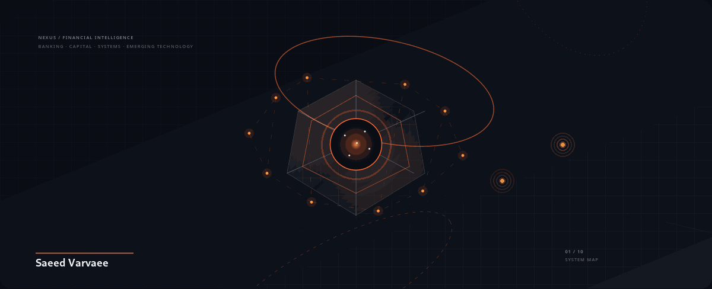
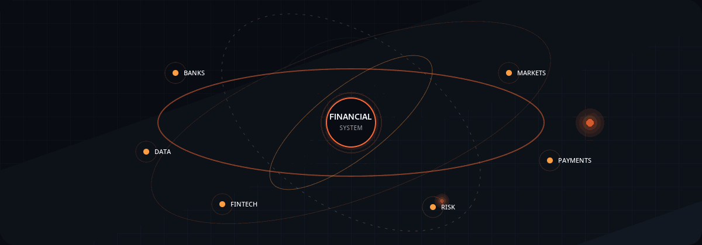
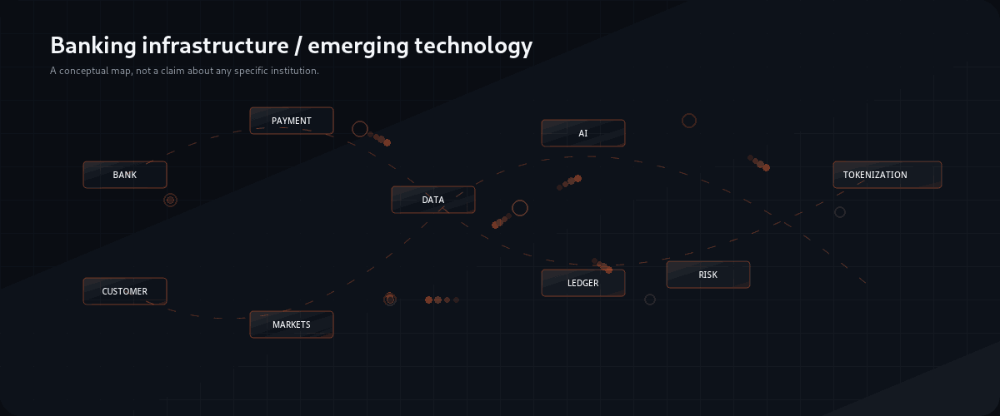
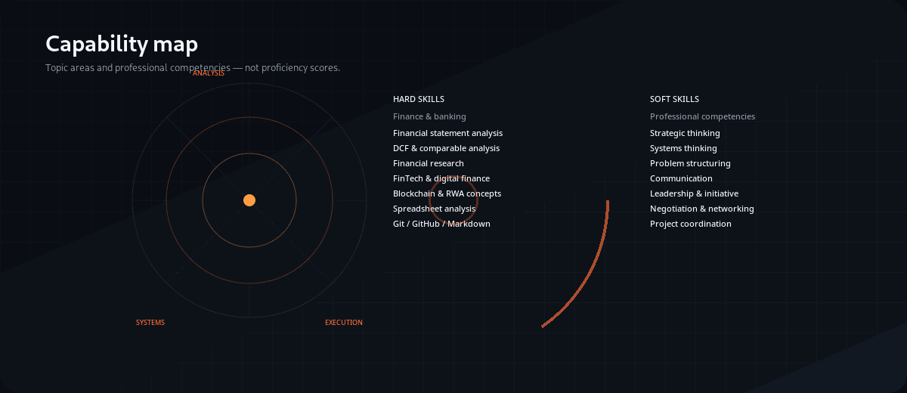
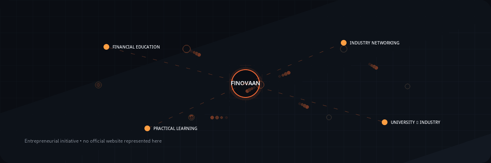
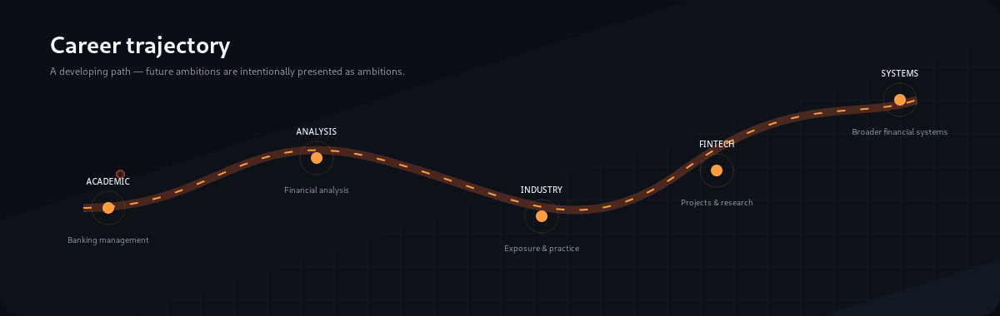
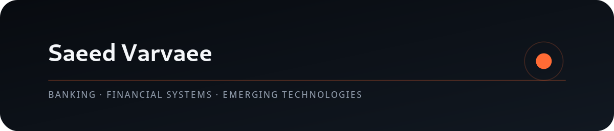

  

  <a href="https://github.com/saeedvarvaee">GitHub</a> ·
  <a href="https://www.linkedin.com/in/saeedvarvaee/">LinkedIn</a> ·
  <a href="https://t.me/finovaan">Finovaan Telegram</a>

  

## Identity

I am a **Banking Management student at the University of Tehran** and **Founder & CEO of Finovaan**.

My work and research interests sit around the relationship between **financial systems, strategic management, financial innovation and emerging technology** — with particular interest in banking, FinTech, AI in finance, blockchain, tokenization and digital finance.

I aim to connect academic learning with practical projects and structured research, while keeping the distinction between what I have practiced, what I am learning, and what I am exploring.

  

## How I Think About Finance

Financial systems are not isolated products. They are networks of institutions, incentives, information, infrastructure and decisions.

I am particularly interested in questions such as:

- How can financial institutions adapt to technology without losing sight of risk and governance?
- Where can AI support financial analysis, decision-making and operational processes?
- How might tokenization interact with existing financial infrastructure?
- How do digital channels change the relationship between financial institutions and customers?
- How can research become a structured project rather than remain only a collection of ideas?

These are **areas of inquiry**, not claims that every emerging technology has already reached mature adoption.

  

## Capability Map

The profile deliberately avoids invented proficiency percentages. The distinction below is about **what I work with or study**, not a measured score.

  

### Hard-skill areas

**Finance & Banking**
- Banking Management
- Financial Systems
- Financial Statement Analysis
- Investment Banking Fundamentals
- DCF Valuation Fundamentals
- Comparable Company Analysis
- Financial Risk Concepts
- Business & Financial Research

**FinTech & Technology**
- FinTech Business Models
- Blockchain Fundamentals
- Real-World Asset Tokenization
- AI Applications in Finance
- Digital Banking
- Financial Innovation
- Technology & Business Strategy

**Business & Digital Tools**
- Business Model Design
- Market Research
- Strategic Analysis
- Project Planning
- Business Development
- Presentation & Proposal Development
- Spreadsheet-Based Analysis
- Data Visualization Fundamentals
- Technical Documentation
- Git, GitHub & Markdown
- SVG Design & Optimization

### Soft-skill areas

- Strategic Thinking
- Systems Thinking
- Analytical Reasoning
- Problem Structuring
- Leadership
- Entrepreneurship
- Communication
- Negotiation
- Networking
- Project Coordination
- Critical Thinking
- Presentation
- Cross-functional Collaboration

These are professional competencies and areas of practice, **not objectively measured personality scores**.

  

## Finance × Technology

The intersection I keep returning to is:

**Banking infrastructure → Financial markets → Digital finance → AI → Risk → Tokenization**

The goal is not to predict the future with certainty. It is to understand the mechanisms, trade-offs and implementation questions behind changes in financial infrastructure.

  

## Finovaan

**Finovaan** is my financial education, media and professional networking initiative.

Its focus is:

- Financial education
- Practical learning
- University–industry connections
- Professional networking
- Emerging developments in finance

There is **no official Finovaan website represented in this profile**. The verified public destination used here is the Telegram channel:

**[Finovaan on Telegram](https://t.me/finovaan)**

## Selected Work & Learning

This profile intentionally does not manufacture a project portfolio where evidence is unavailable.

Current areas include:

- Financial technology concepts and product exploration
- Banking innovation and digital-finance research
- Asset tokenization and real-world asset research
- Financial analysis exercises and educational simulations
- Visual communication and technical documentation

For future public projects, I use a consistent structure:

**Problem → Approach → Tools → Findings → Limitations → Next steps**

Educational simulations are kept distinct from professional employment or client work.

## Career Trajectory

My developing trajectory connects:

**Academic foundations → Financial analysis → Industry exposure → FinTech projects → Broader financial-systems research**

The direction is intentional, but the future stages are ambitions rather than guaranteed outcomes.

  

## A Financial Principle I Keep Close

  

> “Price is what you pay; value is what you get.”

Attributed to **Benjamin Graham**, and quoted by Warren Buffett in Berkshire Hathaway's 2008 Chairman's Letter.

[Source: Berkshire Hathaway — 2008 Chairman's Letter](https://berkshirehathaway.com/letters/2008ltr.pdf)

The quotation is included because it connects directly to a recurring theme in finance: separating **price** from **value**.

## Reading & Research

I follow research and industry material around:

- Banking and financial intermediation
- Financial innovation
- Digital banking
- Tokenized deposits and digital assets
- Real-world asset tokenization
- AI in financial services
- Financial risk
- Strategic management
- Capital allocation

This section is a map of research interests, **not a claim of completed reading history**.

## Connect

  

- **GitHub:** [saeedvarvaee](https://github.com/saeedvarvaee)
- **LinkedIn:** [Saeed Varvaee](https://www.linkedin.com/in/saeedvarvaee/)
- **Finovaan:** [Telegram channel](https://t.me/finovaan)

---

  NEXUS / FINANCIAL INTELLIGENCE · Built as a lightweight, evidence-led GitHub identity.

